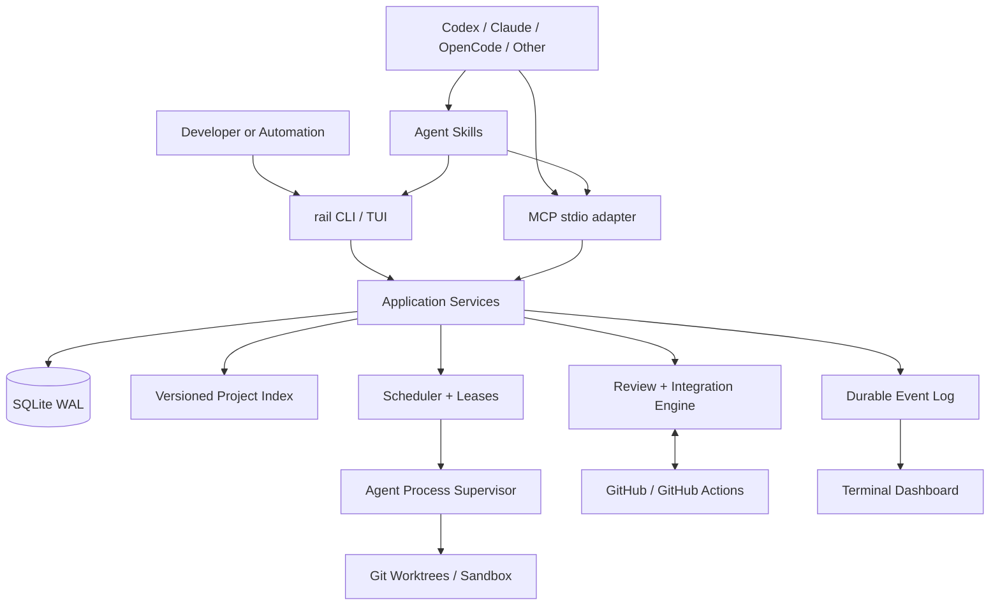

# Agent Rail

Agent Rail coordinates independent AI coding agents (Codex, Claude Code, OpenCode and others) working in the same repositories. It owns task claiming, isolated worktrees, versioned repository context, reviews, validation, pull-request integration, recovery and observability. Agents do not need to share an LLM provider or a conversation.

It runs locally: a `rail` CLI, an MCP server over stdio (`rail mcp`), portable Agent Skills, an optional background service and a terminal dashboard, all calling the same application services. State lives in a local SQLite database. There is no hosted backend; the only network services are the LLM providers and GitHub you configure.

> Status: under development toward v1.0. Command and tool names follow the [v1.0 specification](docs/reference/cli.md); check `rail <command> --help` for what your build implements.

## How it works

1. You describe a goal. A planning agent proposes a task DAG; Rail validates it and you approve it.
2. The scheduler admits tasks that are ready, within WIP limits and without conflicting scope reservations.
3. Each agent claims a task (an atomic lease with a fencing generation), works in its own Git worktree, and hands off structured evidence.
4. Rail opens or attaches the PR, runs incremental review, and queues it for integration through GitHub's merge queue or a serialized fallback, never bypassing branch protection.
5. After a merge, Rail reconciles state, re-indexes the base and unblocks dependent tasks. Crashes and failures resume from durable state.



## Requirements

- Git 2.38 or newer
- GitHub CLI (`gh`) authenticated, for GitHub integration
- At least one agent host or provider CLI (Codex CLI, Claude Code, OpenCode, or a generic process)
- Bun 1.4.4 or newer only when installing from npm or source; release binaries embed the runtime

Linux (x64, arm64), macOS (arm64, x64) and Windows (x64) are supported.

## Install

Download the binary for your platform from the GitHub release, verify it, and put it on `PATH`:

```bash
curl -LO https://github.com/<owner>/agent-rail/releases/download/v1.0.0/rail-linux-x64
curl -LO https://github.com/<owner>/agent-rail/releases/download/v1.0.0/SHA256SUMS
sha256sum --ignore-missing -c SHA256SUMS
gh attestation verify rail-linux-x64 --repo <owner>/agent-rail
install -m 755 rail-linux-x64 ~/.local/bin/rail
```

Alternatives (Bun runtime, from source), upgrades and uninstalling are covered in [docs/installation.md](docs/installation.md).

## Quick start

### Bootstrap a repository (J-01)

```bash
rail doctor                                   # runtime, git, gh, storage, providers, secret store
cd ~/src/my-repo
rail init --repo .                            # writes .agent-rail/config.yaml, initializes local state
gh auth login                                 # GitHub access used by Rail
rail account add --provider codex --name personal
rail agent create --name engineer --provider codex --account personal
rail install --target codex,claude,opencode --dry-run   # review the pending changes
rail install --target codex,claude,opencode             # MCP registration + Skills, with backups
rail index build
rail doctor                                   # readiness report
```

### Run a goal to merged PRs (J-02)

```bash
rail goal create --title "Add JWT authentication" --description-file goal.md
rail goal plan GOAL-1 --agent architect       # planning agent proposes a task DAG
rail goal approve GOAL-1                      # operator approval gate
rail service start                            # continuous scheduling, sessions, GitHub polling
rail dashboard                                # live tasks, agents, queue, events
rail queue explain --pr 148 --json            # why a PR is or is not merging
```

Continuous autonomous work needs `rail service run`/`start` (or an installed user service). Closing an MCP host does not keep work running.

## Interfaces

| Surface | Use |
|---|---|
| `rail` CLI | Operators, scripts and shell-capable agents. Every read command supports `--json`. [Reference](docs/reference/cli.md) |
| `rail mcp` | MCP server over stdio for agent hosts: `rail_*` tools, `rail://` resources, `execution-handoff` prompt. [Reference](docs/reference/mcp.md) |
| Skills | `rail-planning`, `rail-execution`, `rail-review`, `rail-integration`, `rail-recovery`, `rail-context`. [Guide](docs/skills.md) |
| `rail dashboard` | Terminal UI over the durable event stream |

Skills are guidance. Leases, scopes, state transitions, policy and GitHub permissions are enforced by Rail regardless of what an agent asks for.

## Documentation

- [Installation, upgrades, backups](docs/installation.md)
- [`rail doctor` and troubleshooting](docs/doctor.md)
- [MCP configuration per host](docs/mcp-hosts.md) and [Agent Skills](docs/skills.md)
- [Security model](docs/policies/security-model.md) and [default policies](docs/policies/default-policies.md)
- [Architecture overview](docs/architecture/overview.md), [desktop integration](docs/architecture/desktop-integration.md), [ADRs](docs/adr.md)
- [Incident and recovery runbooks](docs/incident-recovery/runbooks.md)
- [CLI reference](docs/reference/cli.md), [MCP reference](docs/reference/mcp.md), [example configuration](docs/examples/config.yaml)

## Development

```bash
bun install --frozen-lockfile
bun run typecheck
bun run lint
bun test
bun run build:binaries   # dist/rail-<os>-<arch>, manifest.json, SHA256SUMS
bun run sbom             # dist/sbom.cdx.json (CycloneDX 1.6)
```

Contributor conventions are in [AGENTS.md](AGENTS.md).
