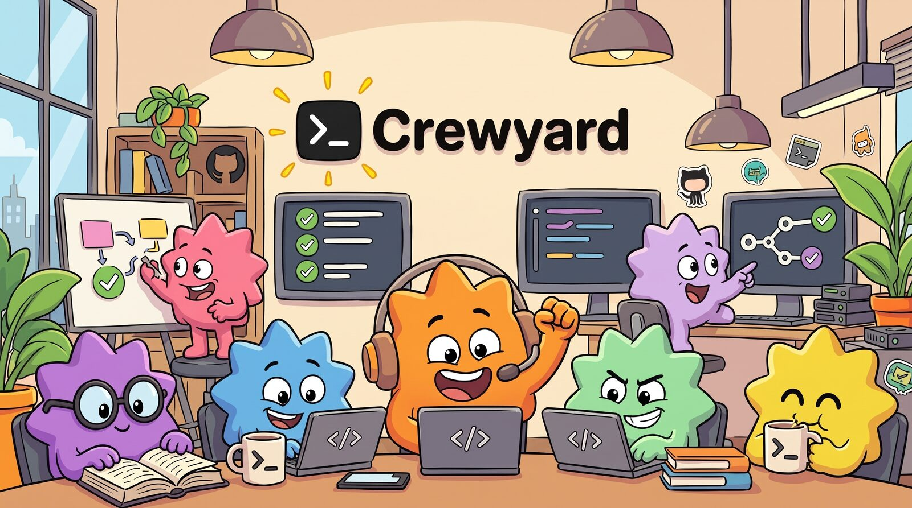
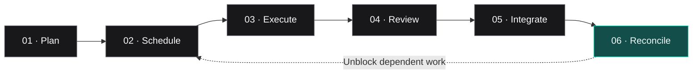
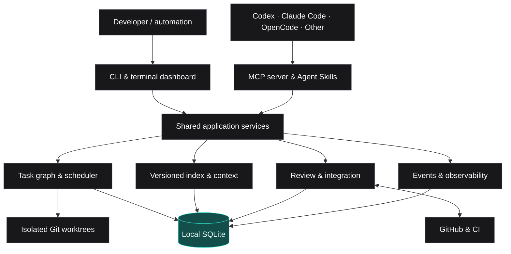

<!-- Crewyard README · Keep installation instructions consistent with docs/installation.md. -->

<div align="center">

  

  <p><strong>Ship together. Merge safely.</strong></p>

  <p>
    The local-first coordination engine for independent AI coding agents.<br />
    One workflow for planning, parallel execution, review, and integration.
  </p>

  <p>
    <a href="#quick-start"><strong>Get started</strong></a>
    &nbsp;&nbsp;·&nbsp;&nbsp;
    <a href="#how-it-works">How it works</a>
    &nbsp;&nbsp;·&nbsp;&nbsp;
    <a href="docs/architecture/overview.md">Architecture</a>
    &nbsp;&nbsp;·&nbsp;&nbsp;
    <a href="#documentation">Documentation</a>
  </p>

  <p>
    
    
    
    
    <a href="https://www.npmjs.com/package/crewyard"></a>
    <a href="LICENSE"></a>
    <a href="https://github.com/orafaelfragoso/crewyard/actions/workflows/ci.yml"></a>
  </p>

  <sub>In development toward v1.0 · MIT licensed · No hosted backend required</sub>

</div>

<br />

> [!NOTE]
> **Pre-1.0 software.** Crewyard is being developed toward v1.0, and commands and configuration may still change between minor versions. Run `crew <command> --help` to see what your installed version supports, and check the [changelog](CHANGELOG.md) before upgrading.

## Coding agents are good at writing code. Coordinating them is the hard part.

Running multiple independent agents on one repository creates a new set of engineering problems: duplicated work, conflicting edits, stale context, overflowing PR queues, repeated reviews, and merges that invalidate work already in flight.

**Crewyard is the coordination layer between your agents and your repository.** It gives independent agents a shared, durable workflow—without forcing them to use the same model, provider, or chat session.

| Without coordination | With Crewyard |
| :--- | :--- |
| Agents pick up overlapping tasks | Atomic claims, leases, and scope reservations |
| Parallel work collides in one checkout | Isolated Git worktrees per task |
| Context drifts as branches change | Versioned repository indexing and context packs |
| Reviews repeat or become stale | Evidence-aware incremental review |
| PRs accumulate and merges conflict | Serialized integration and GitHub-aware queueing |
| Crashes lose orchestration state | Durable events, reconciliation, and recovery |

## One workflow. From goal to merge.



1. **Plan with dependencies.** Define contracts, scopes and behavioral acceptance checks, then approve a validated task graph.
2. **Schedule safely.** Dispatch ready tasks subject to concurrency limits, dependencies, and reservations.
3. **Run independently.** Assign work to Codex, Claude Code, OpenCode, or another compatible process in isolated worktrees.
4. **Review with evidence.** Bind findings to Git source objects, context, reviewer identity, policy and expiry. Reuse only evidence that remains valid.
5. **Integrate deliberately.** Validate every exposed cumulative merge prefix and recheck current policy and GitHub state before each mutation.
6. **Recover and continue.** Observe the actual merge, track post-merge checks, preserve interrupted work and unblock downstream tasks.

## Built for real engineering workflows

<table>
<tr>
<td width="50%" valign="top">

### Multi-agent, multi-provider

Use independent coding agents and account profiles without tying the workflow to one LLM provider.

**Adapters:** Codex · Claude Code · OpenCode · Ollama · Generic process

</td>
<td width="50%" valign="top">

### Owned execution and worktrees

Atomic task claims, fenced execution attempts, bounded subprocess workers and dedicated Git worktrees keep ownership explicit across concurrent callers.

</td>
</tr>
<tr>
<td valign="top">

### Repository-aware context

Pin indexing and retrieval to exact commits. Durable reader claims protect snapshots while context is assembled; retrieved code carries commit and blob provenance.

</td>
<td valign="top">

### Review-to-merge orchestration

Track review evidence, integration readiness, GitHub checks, queue state, and merge outcomes across the full task lifecycle.

</td>
</tr>
<tr>
<td valign="top">

### Local by design

Keep orchestration state in a local SQLite database. No Crewyard-hosted backend is required; configured providers and GitHub may still use network services.

</td>
<td valign="top">

### Multiple ways to interact

Operate through a CLI, MCP tools, portable Agent Skills, a background service, or a terminal dashboard—all backed by the same application services.

</td>
</tr>
</table>

## Installation

Crewyard targets **Linux (x64, arm64)**, **macOS (Apple Silicon, Intel)**, and **Windows (x64)**. You need Git 2.38+, at least one compatible coding-agent CLI, and the authenticated [GitHub CLI](https://cli.github.com/) for GitHub integration.

### Install with npm

```bash
npm install --global crewyard
crew version
```

npm installs a prebuilt binary for your platform; Node.js 22+ is only needed for the small launcher. Standalone binaries that need neither Node.js nor Bun are attached to every [GitHub release](https://github.com/orafaelfragoso/crewyard/releases).

### Install from source

Requires [Bun 1.4.4+](https://bun.sh/).

```bash
git clone https://github.com/orafaelfragoso/crewyard.git
cd crewyard
bun install --frozen-lockfile
bun run crew doctor
```

In a source checkout, run `bun run crew` from the repository root wherever this README uses `crew`.

See [installation and upgrades](docs/installation.md) for supported platforms, direct binary installs, checksums, backups, and removal.

## Quick start

New to Crewyard? The [getting-started guide](docs/getting-started.md) walks through every step and what each one does.

```bash
# 1. Register your repository
cd ~/src/my-repo
crew doctor
crew init --repo .

# 2. Add an account: reuse the Claude Code login you already have
crew account add --provider claude --name personal --use-default-config
crew account test claude/personal

# 3. Create agents that use it, and turn on AI review
crew agent create --name architect --role architect --account claude/personal
crew agent create --name engineer  --account claude/personal
# Replace this with a model ID supported by your account.
REVIEW_MODEL='your-provider-model-id'
crew agent create --name reviewer --role reviewer --account claude/personal --model "$REVIEW_MODEL"
crew config set review.reviewer_agent reviewer --yes

# 4. Give it a goal, review the plan, approve it
crew goal create --title "Add JWT authentication" --description-file goal.md
crew goal plan GOAL-1 --agent architect
crew goal status GOAL-1
crew goal approve GOAL-1 --yes

# 5. Let it work, and watch
crew service start
crew dashboard
```

`GOAL-1` is the ID that `goal create` prints. Codex and OpenCode work the same way with `--provider codex` or `--provider opencode`. For separate logins, several accounts or API keys, see [Accounts](docs/accounts.md); to change or remove agents, see [Agents and policies](docs/agents.md).

To let Claude Code, Codex and OpenCode sessions you start yourself use Crewyard's tasks and tools, run `crew install` (add `--dry-run` first to see the changes). The guide lists [where it installs the MCP server and Skills](docs/getting-started.md#6-connect-your-own-agent-tools-optional).

Direct CLI and MCP requests drive or join durable operations without a service. The background service keeps scheduling work continuously; closing a calling host does not guarantee continuation. The default worker pool allows six operations globally, four per project and one per project/domain. See [execution limits](docs/architecture/overview.md#execution-limits) for tuning and shutdown behavior.

<p><a href="docs/getting-started.md"><strong>Getting started →</strong></a> &nbsp;·&nbsp; <a href="docs/accounts.md"><strong>Accounts →</strong></a> &nbsp;·&nbsp; <a href="docs/agents.md"><strong>Agents →</strong></a> &nbsp;·&nbsp; <a href="docs/reference/cli.md"><strong>CLI reference →</strong></a></p>

## How it works

Crewyard is a local orchestration system, not an LLM gateway. It coordinates tools you already use while maintaining its own authoritative task and integration state.



**The architecture is deliberately provider-agnostic.** The CLI and MCP server are thin interfaces over shared application services. SQLite WAL provides durable coordination; external GitHub and process side effects are reconciled rather than treated as a single database transaction.

Exact commit fetches share immutable objects across processes without moving branch refs. Incremental indexing reuses unchanged blobs; snapshot membership still scales with repository size. Full worktrees and independent bootstrap commands remain the supported execution path. The [benchmark method and results](docs/benchmarks/method.md) record the measurements and decisions.

For an engineering-level explanation, see the [architecture overview](docs/architecture/overview.md), [indexing model](docs/architecture/indexing.md), and [task/lease design](docs/architecture/tasks-and-leases.md).

## Interfaces

| Interface | Designed for | Reference |
| :--- | :--- | :--- |
| **CLI** (`crew`) | Humans, scripts, and command-capable agents | [CLI reference](docs/reference/cli.md) |
| **MCP** (`crew mcp`) | Agent hosts that support Model Context Protocol | [MCP reference](docs/reference/mcp.md) |
| **Agent Skills** | Portable instructions for planning, execution, review, integration, recovery, and context | [Skills guide](docs/skills.md) |
| **Local service** (`crew service`) | Continuous dispatch, reconciliation, and integration | [Architecture](docs/architecture/overview.md) |
| **Terminal dashboard** (`crew dashboard`) | Operational visibility into active work and events | [CLI reference](docs/reference/cli.md) |

## Safety and recovery

Crewyard enforces coordination through its application services:

- **Fenced task leases** prevent stale workers from submitting work as the current owner.
- **Scoped worktrees** separate parallel tasks and protect developer checkouts.
- **Approval and policy gates** control high-impact transitions.
- **GitHub branch protections** remain authoritative during integration.
- **Reconciled outbox operations** check observed outcomes before retrying. Provider work can repeat after a crash; execution is not exactly once.
- **Local credential handling** keeps secrets out of repository configuration and orchestration event logs.

Workers run as your OS user; worktrees and process boundaries are not an OS sandbox. Recovery verifies process identity before termination or resource reuse and preserves resources when ownership cannot be established. GitHub's head-only merge API cannot reserve the base: an unexpected landed tree is detected after the merge and pauses later local merges. Native merge-group checks remain preferred. Read the [security model](docs/policies/security-model.md) and [integration design](docs/architecture/integration.md) before enabling unattended workflows.

## Documentation

| Start here | Learn more |
| :--- | :--- |
| [Getting started](docs/getting-started.md) | From install to your first agent-run task, step by step |
| [Accounts](docs/accounts.md) | Logging agents in: existing logins, separate logins, API keys |
| [Agents and policies](docs/agents.md) | Roles, using several accounts, changing and removing agents |
| [Installation](docs/installation.md) | Supported setups, local data, upgrades, and backups |
| [CLI reference](docs/reference/cli.md) | Commands, options, and machine-readable output |
| [MCP host setup](docs/mcp-hosts.md) | Connecting existing coding-agent tools |
| [Agent Skills](docs/skills.md) | Reusable workflows for compatible agents |
| [Architecture](docs/architecture/overview.md) | Services, storage, scheduling, and system boundaries |
| [Security model](docs/policies/security-model.md) | Trust boundaries, permissions, and operational safety |
| [Recovery runbooks](docs/incident-recovery/runbooks.md) | Failures, restarts, and reconciliation |
| [Metrics definitions](docs/architecture/overview.md#metrics-and-operation-events) | Local validation, hosted check observations, reuse and operation timing |
| [Acceptance matrix](docs/acceptance.md) | Automated evidence and open GitHub, provider and platform release gates |

## Development

The codebase is a Bun/TypeScript monorepo with packages for scheduling, providers, indexing, reviews, integration, storage, and telemetry.

```bash
bun install --frozen-lockfile
bun run typecheck
bun run lint
bun test
bun run build:binaries  # platform binaries, manifest and checksums
bun run build:npm       # npm tarballs, after binaries have been built
```

See [AGENTS.md](AGENTS.md) for code conventions, the [architecture documentation](docs/architecture/overview.md) for package boundaries, and the [release process](docs/releasing.md) for distribution.

## Contributing

Contributions are welcome. Read the [contributing guide](CONTRIBUTING.md) and the [code of conduct](CODE_OF_CONDUCT.md), and use [GitHub Issues](https://github.com/orafaelfragoso/crewyard/issues) for bug reports and feature requests. Report vulnerabilities privately as described in the [security policy](SECURITY.md).

## Project status & licensing

Crewyard is **under active development toward v1.0**. Releases are cut automatically from `main` with [release-please](https://github.com/googleapis/release-please); every release is listed in the [changelog](CHANGELOG.md) and on the [releases page](https://github.com/orafaelfragoso/crewyard/releases). See the [release process](docs/releasing.md) for how npm packages and platform binaries are built and published.

Local Linux tests cover direct and packaged workers, cancellation, recovery and evidence guards. Real GitHub organization/merge-queue runs, authenticated multi-provider delivery and actual macOS/Windows worker acceptance remain open; the [acceptance matrix](docs/acceptance.md#not-yet-demonstrated) distinguishes those gates from local fixtures.

Licensed under the [MIT License](LICENSE). Copyright © 2026 Rafael Fragoso.

---

<div align="center">
  <p><strong>More agents. Less coordination overhead.</strong></p>
  <sub>Built for developers who want autonomous work to reach a safe, reviewable merge.</sub>
  <br /><br />
  <a href="#quick-start">Get started</a> · <a href="docs/architecture/overview.md">Explore the architecture</a> · <a href="https://github.com/orafaelfragoso/crewyard/issues">Issues</a>
</div>
