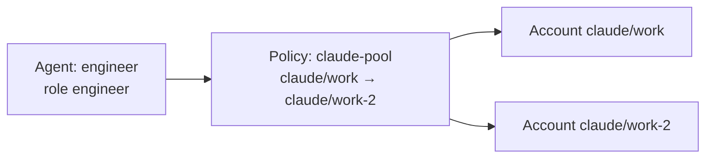

# Agents and policies

An **agent** is a worker with a job (its role) and a way to log in (an account, or a policy of several accounts). You create agents once and reuse them across goals.



- An **account** is one login for one agent CLI, such as `claude/work`. See [Accounts](accounts.md).
- A **policy** is an ordered list of accounts an agent may use, plus optional rules.
- An **agent** uses exactly one policy. `--account` is a shortcut that creates a one-account policy for you.

## Roles

| Role | What it does | Needed for |
|---|---|---|
| `architect` | Turns a goal into a task plan. Never edits files. | `crew goal plan --agent <name>` |
| `engineer` | Implements one task in its own Git worktree and commits. Default role. | Running tasks |
| `reviewer` | Reviews submitted work before it is merged. | Reviews |

You can use other role names; Crewyard schedules work by role, so a task meant for engineers goes to agents with the `engineer` role.

## Create an agent

With one account (the provider is taken from the account):

```bash
crew agent create --name engineer --account claude/personal
```

Useful options:

| Option | Example | Meaning |
|---|---|---|
| `--role` | `--role reviewer` | The agent's job (default `engineer`) |
| `--model` | `--model opus` | Preferred model; otherwise the CLI's default |
| `--max-parallel` | `--max-parallel 3` | How many tasks this agent may run at once (default 1) |
| `--instructions` | `--instructions "Prefer small commits"` | Extra system instructions for every session |
| `--review-authority` | `--review-authority required` | For reviewers: `advisory` (default) or `required` before merge |

## Use several accounts: policies

Use a policy when one agent should be able to use more than one account, for example two subscriptions:

```bash
crew account policy create claude-pool --accounts claude/work,claude/work-2 --allow-fallback
crew agent create --name engineer --policy claude-pool
```

How Crewyard picks an account for each task:

1. It tries the accounts in the order you listed them.
2. It skips an account that is rate limited or not logged in, **only if** the policy has `--allow-fallback`. Without it, the agent only ever uses the first account, and its work waits while that account is rate limited.
3. `--models opus,sonnet` limits which models the agent may use with these accounts.

`crew task explain <task>` shows which account was chosen for a task and why.

## Change an agent

```bash
crew agent update engineer --policy claude-pool       # switch to a policy
crew agent update engineer --account codex/personal   # or to a single account (provider follows the account)
crew agent update engineer --model opus --max-parallel 2
crew agent update engineer --instructions ""          # clear the extra instructions
```

Sessions already running keep their old settings; the next task uses the new ones. When a change leaves a policy unused, the command says so and gives the command to remove it.

## Remove an agent

```bash
crew agent remove engineer --dry-run   # shows what would happen
crew agent remove engineer --yes
```

Removing is refused while the agent is busy, and the error says what to do:

| Refused because | Do this first |
|---|---|
| It has a running session | `crew agent stop <sessionId>` (see `crew agent sessions`) |
| It holds a claimed task | `crew task retry <task> --reason "agent removed"` to put the task back in the queue |

Tasks that were only assigned to the agent go back to the shared queue. The agent's history stays in the event log.

## Manage policies

| Task | Command |
|---|---|
| List policies, their accounts and the agents using them | `crew account policy list` |
| Show one | `crew account policy show claude-pool` |
| Change the accounts or their order | `crew account policy update claude-pool --accounts claude/work-2,claude/work` |
| Turn fallback on or off | `crew account policy update claude-pool --allow-fallback` / `--no-allow-fallback` |
| Remove an unused policy | `crew account policy remove claude-pool --yes` |

A policy that an agent still uses cannot be removed; move the agent first with `crew agent update`.

## Commands at a glance

| Task | Command |
|---|---|
| List agents with their accounts | `crew agent list` |
| Full details of one | `crew agent show engineer` |
| Run one task now, in the foreground | `crew agent run engineer --task TASK-1` |
| See running sessions | `crew agent sessions` |
| Read a session's output | `crew agent logs <sessionId>` |
| Stop a session | `crew agent stop <sessionId>` |
