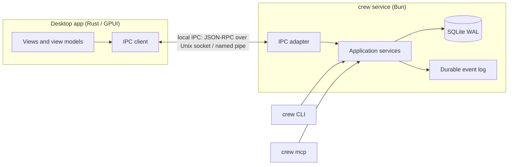

# Desktop integration

V1 has no graphical app. This page describes how a future native desktop app (Rust with GPUI) can reuse Crewyard's core without rebuilding it (ADR-010, goal G-10).

## Principle

The UI is another interface over the same application services, like the CLI, the MCP server and the TUI. It owns presentation only. Workflow rules, state, policy and side effects stay in the TypeScript services and the SQLite database.

## What the desktop app reuses

| Need | Reused contract |
|---|---|
| Commands (claim, approve, pause, retry, cancel, explain) | Application service calls with the same input/output DTOs and `ToolEnvelope` (`ok`, `data`/`error`, `operationId`, `revision`) used by MCP |
| Errors | `CrewError` codes, `retryable` and `suggestion`, unchanged |
| Live updates | The durable event stream: subscribe from a sequence cursor, and reload the projection on a gap, exactly as the TUI does |
| Read models | Telemetry projections that back the dashboard (tasks, sessions, queue, metrics) |
| Authorization | The operator role of the local user; destructive actions require explicit confirmation |

## The IPC boundary

- **Transport.**
  - Local only: a Unix domain socket in the user's data `run/` directory, or a Windows named pipe, with user-only permissions.
  - No TCP listener by default. If one is ever added, it must follow FR-SEC-07: loopback only, token authentication, origin validation and explicit opt-in.
- **Protocol.**
  - JSON-RPC 2.0 messages over newline-delimited JSON.
  - Methods mirror application services (for example `tasks.claim`, `queue.explain`, `events.subscribe`).
  - Payloads are the existing DTOs; schemas come from the same Zod definitions the MCP tools use, exported as JSON Schema for the Rust client.
- **Versioning.** The handshake returns the Crewyard version, the schema version and supported methods. Optional fields may be added compatibly; breaking changes need a new method version, as with MCP tools.
- **Process model.**
  - The desktop app starts or attaches to `crew service run` and does not embed the Bun runtime.
  - If the service is not running, the app shows that autonomous work is stopped rather than implying it continues.
  - Multiple clients (desktop, CLI, MCP) remain safe because all writes go through short database transactions with fencing.
- **Secrets.** The app never receives credentials. Account setup runs through the same service calls that write to the OS secret store.

## Rules that keep this possible

- Application services take a `CrewContext` and return plain data. They never print, prompt or read terminal state.
- Interfaces never implement workflow rules. A rule added only to the CLI would be missing from MCP and the desktop app.
- Long-running work is driven by the service and reported through events, never by holding a client connection open.
- Event payloads carry a schema version and stay backward compatible, so an older desktop build can still render history.
