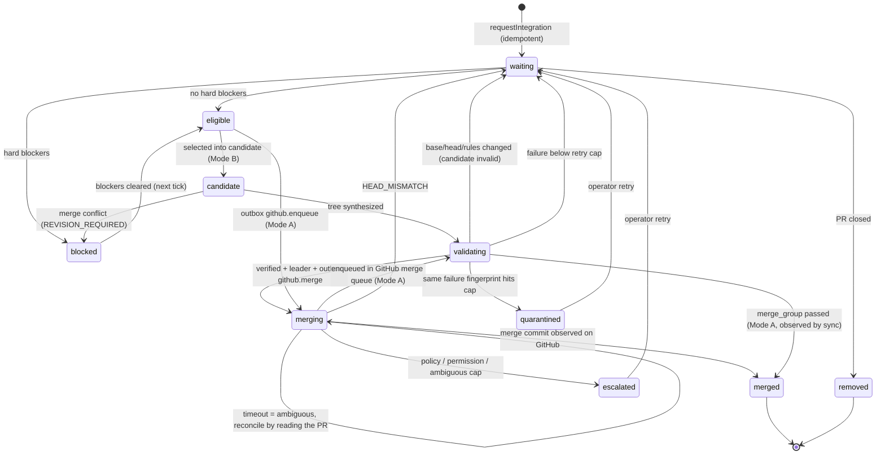

# Review and integration engine

Packages: `@agent-rail/github`, `@agent-rail/reviews`, `@agent-rail/integration`. Operator-facing behaviour
(permissions, queue modes, stacks) is in [GitHub](../github.md).

The integration package never imports `@agent-rail/tasks` or `@agent-rail/context`. Task effects go through injected
`TaskHooks` (`onQueued`, `onValidating`, `onMerged`, `onBlocked`, `onEscalated`, `onRevisionRequired`), called after the
owning transaction commits; a failing hook is logged and recorded as `integration.hook_failed`. Review context comes
from an injected `ContextFingerprintProvider`.

## Bounded tick

`queueTick(ctx, repositoryId, { leaderId })` runs one bounded cycle:

1. `syncRepository` fetches authoritative GitHub state (stops all remote mutations when offline or rate limited).
2. `processIntegrationOutbox` reconciles ambiguous and interrupted operations before anything new happens.
3. Per queue: acquire or renew the leadership lease `integration:<repositoryId>:<base>`; refresh the mode; recompute
   eligibility for every entry and request operator approval where policy needs it; retarget chain children whose
   parent merged.
4. Mode A enqueues eligible PRs into the GitHub merge queue. Mode B builds, validates, verifies and merges at most
   `maxCandidates` candidates; an invalidated candidate is rebuilt in the same tick on the new base.

## Merge state

Candidate states: `building → validating → valid → merged`, or `failed` (conflict or validation failure) or `invalid`
(base, head, rules or leadership changed; PR merged elsewhere; process interrupted).

## Side effects and reconciliation

All GitHub mutations are outbox operations (`github.merge`, `github.merge_async`, `github.enqueue`,
`github.create_pr`, `github.update_pr`) with idempotency keys such as `merge:<repo>:<pr>:<head_sha>`, the expected
head/base and the leader generation. A terminal failure for the same key is revived instead of duplicated. Every
handler first reads GitHub: a PR already merged is adopted with its real `merge_commit_sha`; a changed head fails with
`HEAD_MISMATCH`; a PR already in the merge queue counts as enqueued; an existing PR for the head branch is attached
instead of creating a second one. Only then, after re-checking the leadership generation, does it call GitHub, and it
records every call in `remote_operations`. `MERGED` is recorded only from an observed PR carrying a merge commit SHA.
A crash at any point leaves the operation `attempted` or `ambiguous`; the next worker reconciles it, so merges are
never repeated (AT-09, AT-18).

## Review evidence

`requestReview` computes an evidence fingerprint from the repository, the normalized patch (whitespace-insensitive,
context-free hunks) and per-file hashes, review policy version, reviewer identity/model/prompt version, the
dependency and interface fingerprints from the context provider (or the base SHA when no provider is wired), the symbol
graph revision and the security classification. All inputs are stored with the artifact. The cache decision follows
§21.2: reuse on an identical fingerprint (unless caching is off, the prior is expired or low-confidence, or a security
review of sensitive paths is required); incremental review when only the patch changed in a bounded set of files and
the dependency graph is known; full review otherwise. A changed interface or dependency context always triggers an
integration review. Review results never satisfy GitHub checks; they can only add blockers (`REVIEW_FINDINGS_OPEN`,
`HIGH_RISK_REVIEW_REQUIRED`).

Validation runs (`runValidation`) are separate from reviews and store commands, environment fingerprint, exit code,
duration, output file under `dirs.artifacts/validation/` and the exact commit and tree.
