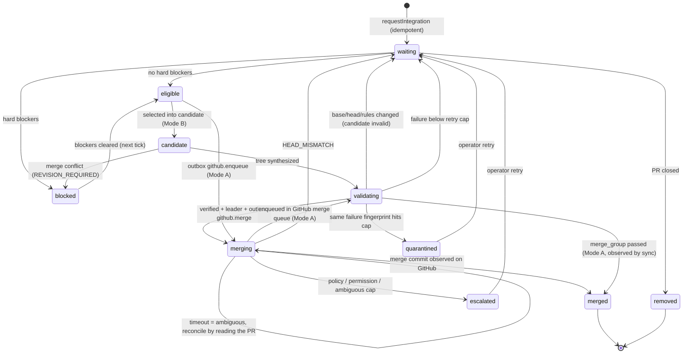

# Review and integration engine

Packages: `@crewyard/github`, `@crewyard/reviews`, `@crewyard/integration`. Operator-facing behaviour
(permissions, queue modes, stacks) is in [GitHub](../github.md).

The integration package never imports `@crewyard/tasks` or `@crewyard/context`. Task effects go through injected
`TaskHooks` (`onQueued`, `onValidating`, `onMerged`, `onBlocked`, `onEscalated`, `onRevisionRequired`), called after the
owning transaction commits; hook calls are persisted as `integration.hook` outbox intents before invocation, fenced and retried with bounded backoff. `onMerged` reconciles already completed tasks; arbitrary callbacks still need idempotent effects. Failures are recorded as `integration.hook_failed`. Review context comes
from an injected `ContextFingerprintProvider`.

## Bounded tick

`queueTick(ctx, repositoryId, { leaderId })` runs one bounded cycle:

1. `syncRepository` fetches authoritative GitHub state (stops all remote mutations when offline or rate limited).
2. `processIntegrationOutbox` reconciles ambiguous and interrupted operations before anything new happens.
3. Per queue: acquire or renew the leadership lease `integration:<repositoryId>:<base>`; refresh the mode; recompute
   eligibility for every entry and request operator approval where policy needs it; retarget chain children whose
   parent merged.
4. Mode A enqueues eligible PRs into the GitHub merge queue. Mode B builds, validates, verifies and merges at most
   `maxCandidates` candidates; an invalidated candidate is rebuilt in the same tick on the new base.

## Merge state

Candidate states: `building → validating → valid → merged`, or `failed` (conflict or validation failure) or `invalid`
(base, head, rules or leadership changed; PR merged elsewhere; process interrupted).

## Side effects and reconciliation

All GitHub mutations are outbox operations (`github.merge`, `github.merge_async`, `github.enqueue`,
`github.create_pr`, `github.update_pr`) with idempotency keys such as `merge:<repo>:<pr>:<head_sha>`, the expected
head/base and the leader generation. A terminal failure for the same key is revived instead of duplicated. Every
handler first reads GitHub: a PR already merged is adopted with its real `merge_commit_sha`; a changed head fails with
`HEAD_MISMATCH`; a PR already in the merge queue counts as enqueued; an existing PR for the head branch is attached
instead of creating a second one. Every first delivery and retry checks current delivery ownership, leadership, expected live base/head/target, project autonomy and approval, pause/mode, policy/config revision, candidate status/expiry, the corresponding prefix evidence, rules, checks, reviews, dependencies and divergence. Retargeting is followed by another guard. Only then does it call GitHub and record the call in `remote_operations`. `MERGED` is recorded only from an observed PR carrying a merge commit SHA.
A crash at any point leaves the operation `attempted` or `ambiguous`; the next worker reconciles the observed outcome before deciding whether a fresh action is allowed (AT-09, AT-18). An unresolved remote outcome remains blocked; a timeout never proves nonexecution.

## Immutable Git object fetches

`fetchCommit` from `@crewyard/projects` coalesces requests by repository, configured remote identity and full lowercase
commit OID (40-character SHA-1 or 64-character SHA-256). It fetches into `refs/crew/objects/<oid>` with
`--no-write-fetch-head`; branch refs and `FETCH_HEAD` are not updated. Concurrent callers share the transfer and its
failure. A verified dead owner can be recovered before its lease expires; unverifiable ownership does not authorize
takeover. A changed remote URL returns `CONFLICT`.

An object being present proves only that immutable commit is available. Callers separately observe current remote
branches, PR heads, rules and checks before authorizing publication or integration. Cached objects cannot substitute
for those fresh observations. Transfer-byte savings are not measured. See the
[benchmark decisions](../benchmarks/method.md#decisions-on-repeated-work).

## Review evidence

`requestReview` admits source evidence v2 from actual Git objects: object format, merge-base/base/head trees and canonical NUL-safe old/new paths, blobs and modes. Binary, rename, deletion and mode changes retain their identity. Patch rendering is byte-preserving and truncation is explicit. Context binds content, extraction/config revision and coverage, including bounded depth/nodes, unresolved imports and missing paths. A syntax graph never proves semantic completeness. Synthetic and unsupported legacy evidence remains historical and cannot authorize integration.

Exact reuse, incremental reuse and summaries use current policy, context, reviewer/provider/model/prompt, confidence, security, cache and expiry rules. Whole-tree reviewers cannot carry evidence across changed trees. Missing or incomplete context prevents scoped cross-tree reuse. Configured agent reviews require an explicit provider/model. Force skips completed reuse and incremental work; it may join an equivalent active full execution. Cache-disabled/high-risk requests may join active work, never restore completed evidence. Attachments retain the source TTL.

Reviews own durable request/attempt records and atomic cross-process admission. Every request keeps its PR/task attribution. The current fenced owner alone may attach a result; process-bound recovery and fresh input/policy checks handle interrupted attempts. A crash around a provider result may repeat provider work; there is no exactly-once provider guarantee.

## Exposed integration prefixes

Each locally controlled intermediate landing must have matching cumulative-tree evidence, commands, environment, policy and expiry. A passing final tree does not establish earlier prefixes. Missing commands produce an unverified attestation. One native stack API request does not establish atomic landing. High-risk, modified/deleted/renamed or uncertain contract changes stay out of unrelated speculative groups; path disjointness is only a heuristic. A failed prefix records its contributing interaction set rather than arbitrarily blaming the first PR.

GitHub's guarded head-only merge endpoint cannot reserve the base between observation and mutation. After landing, Crewyard reads the actual merge commit/tree and uses that actual SHA for the next prefix. A tree mismatch pauses subsequent local merges and emits an incident; this detects an unexpected merge after it occurred. Native queue checks on the merge-group SHA remain preferred.

## Post-merge observation

Health follows the observed merge SHA and its actual target branch/rules. Required checks may be unknown, pending, failed, passed, superseded or branch-unavailable. Missing protection visibility or check timing is unknown. Provider-reported execution timestamps are recorded once per check identity; partial observation is not total hosted CI cost. A guarded/autopilot failure opens one linked high-risk draft repair task for operator review. Repairs use ordinary task, approval and budget limits; no automatic revert or privilege bypass occurs.

Validation runs (`runValidation`) are separate from reviews and store commands, environment fingerprint, exit code,
duration, output file under `dirs.artifacts/validation/` and the exact commit and tree.
