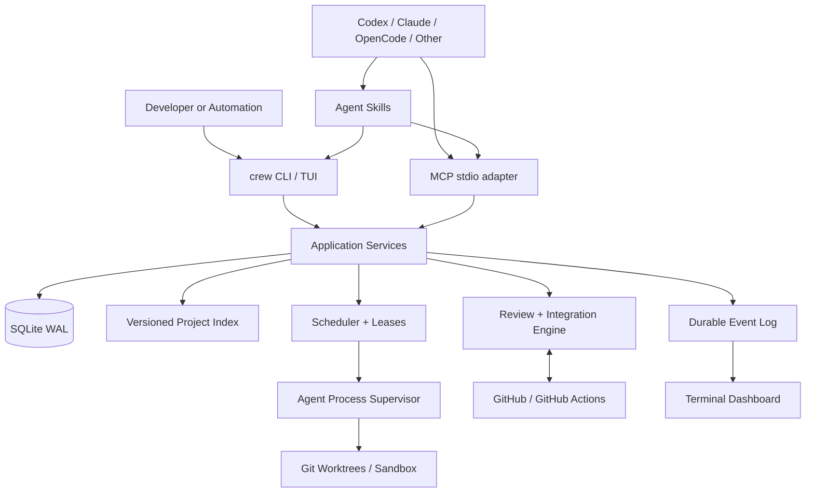
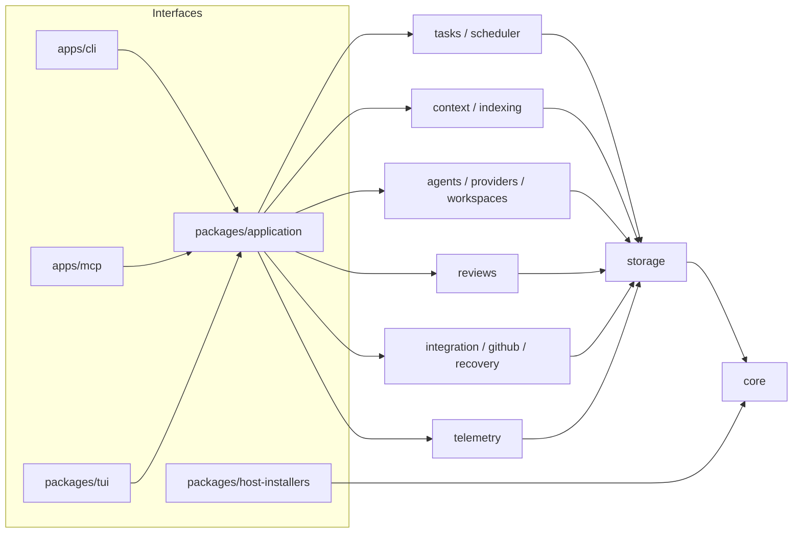
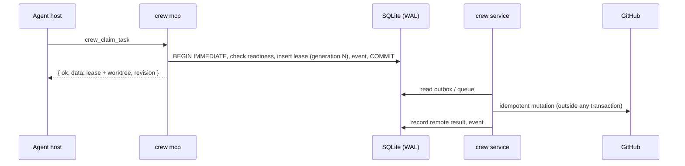
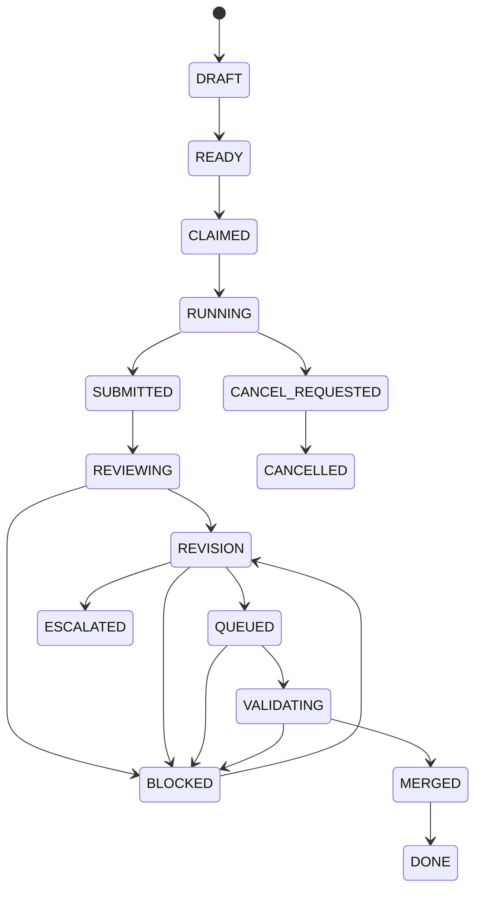

# Architecture overview

Crewyard is a Bun + TypeScript monorepo. Every interface (CLI, MCP server, dashboard, background service) calls the same application services, which own all workflow rules. SQLite in WAL mode is the single local source of truth.

## Deployment topology

## Module boundaries

Modules from the specification (§5.4) and the packages that implement them. Packages import each other only through their package name; there are no circular dependencies.

| Module | Responsibility | Packages |
|---|---|---|
| domain | State machines, DTOs, policy types, typed errors (`CrewError` with stable codes and exit codes) | `packages/core` |
| storage | Migrations, transactions (`BEGIN IMMEDIATE`), event log, outbox, leadership leases | `packages/storage` |
| projects | Repository discovery, configuration, snapshots | `packages/projects`, `packages/config` |
| index | Changed-file processing, text/symbol/reference graph, FTS5 | `packages/indexing` |
| context | Retrieval, citations with provenance, context packs and budgets | `packages/context` |
| tasks | Planning validation, dependencies, leases, reservations, scheduling | `packages/tasks`, `packages/scheduler` |
| agents | Agent definitions, account profiles, provider adapters, sessions | `packages/agents`, `packages/providers/*` |
| workspaces | Worktrees, bootstrap, bounded process execution | `packages/workspaces` |
| reviews | Analyzers, findings, evidence fingerprints, reuse policy | `packages/reviews` |
| integration | PR sync, queue, candidates, CI evidence, merge and recovery | `packages/integration`, `packages/github`, `packages/recovery` |
| telemetry | Events, usage, metrics, dashboard projections | `packages/telemetry`, `packages/tui` |
| interfaces | CLI, MCP server, host/skill installer | `apps/cli`, `apps/mcp`, `packages/host-installers` |
| application | Use-case services shared by every interface | `packages/application` |

Rule: the CLI and the MCP server are thin adapters. They parse input, call an application service with a `CrewContext` (`store`, `dirs`, `logger`, `clock`), and format the result. Neither implements workflow rules.

## Processes

| Process | Lifetime | Role |
|---|---|---|
| `crew <command>` | Short-lived | Calls application services directly, or reads the state the service maintains |
| `crew mcp` | One per MCP host session | stdio MCP server: protocol on stdout, diagnostics on stderr. Many can run at once. |
| `crew service run` | Long-running, optional | Task dispatch, provider sessions, GitHub polling, queue processing, reconciliation |
| `crew dashboard` | Interactive | Follows the durable event stream; operator actions go through the same services |

The service is optional for installation, but continuous autonomous execution needs `crew service run`, `crew service start` or an installed user service. Closing an MCP host does not imply work continues.

## Single-writer coordination

SQLite WAL allows many readers and one writer at a time.

- **Short write transactions.** Every critical transition runs in a short `BEGIN IMMEDIATE` transaction (`Store.immediate`, synchronous callback) with a bounded busy timeout. Constraints are checked inside the transaction, and transient `BUSY` contention is retried with backoff and jitter.
- **No slow work under a lock.** No network, LLM or subprocess work happens while a transaction is open.
- **State and events commit together.** Every state change writes its event and audit record in the same transaction.
- **Side effects go through an outbox.** GitHub mutations, process launches and notifications are recorded as outbox operations with idempotency keys. Workers reconcile remote state after a timeout before retrying.
- **Leases are fenced.** Task leases carry a monotonic generation and a hashed claim token. A stale generation cannot heartbeat, submit or mutate.
- **One integration leader per branch.** One integration-controller leader per repository and base branch holds a durable leadership lease with a generation. It re-checks that lease before every externally visible action.
- **In-process locks never replace database transactions.** Many CLI and MCP instances can safely run at the same time.

This is the task state machine from the specification (FR-TSK-03): any active state can move to `CANCEL_REQUESTED`, and repeated or non-recoverable failures move to `ESCALATED`. Transitions outside the defined guards return `INVALID_TRANSITION` with the allowed next states. Details: [tasks and leases](tasks-and-leases.md), [integration](integration.md), [indexing](indexing.md).

## Local state

Data lives in the OS application-data directory (see [installation](../installation.md#where-data-lives)): the database, index cache, worktrees, artifacts, logs and backups. Repository configuration is `.crewyard/config.yaml`; credentials are only in the OS secret store.

## Desktop reuse

Application services do not depend on any UI. A future native desktop app reuses them through local IPC; see [desktop integration](desktop-integration.md).
