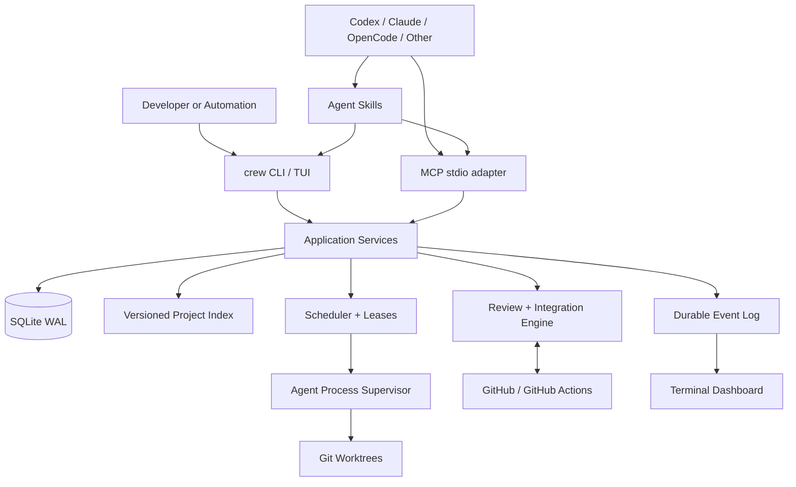
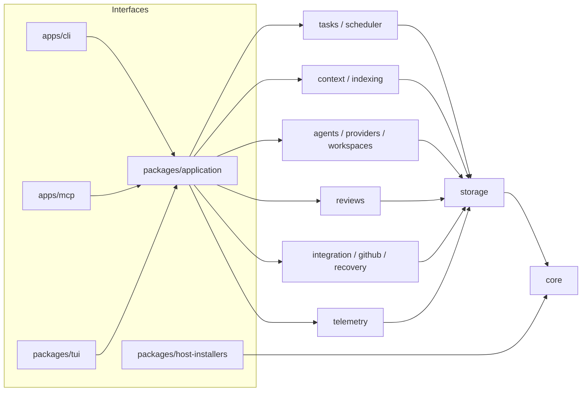
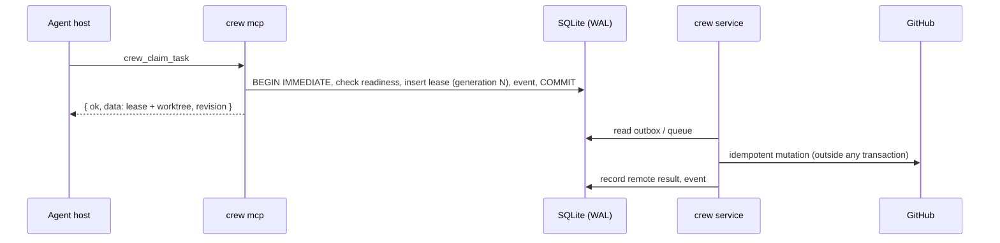
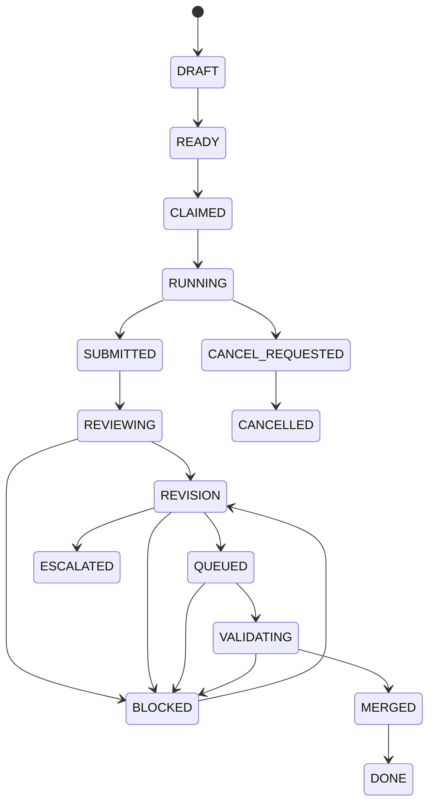

# Architecture overview

Crewyard is a Bun + TypeScript monorepo. Every interface (CLI, MCP server, dashboard, background service) calls the same application services, which own all workflow rules. SQLite in WAL mode is the single local source of truth.

## Deployment topology

## Module boundaries

Modules from the specification (§5.4) and the packages that implement them. Packages import each other only through their package name; there are no circular dependencies.

| Module | Responsibility | Packages |
|---|---|---|
| domain | State machines, DTOs, policy types, typed errors (`CrewError` with stable codes and exit codes) | `packages/core` |
| storage | Migrations, transactions (`BEGIN IMMEDIATE`), event log, outbox, leadership leases | `packages/storage` |
| projects | Repository discovery, configuration, snapshots | `packages/projects`, `packages/config` |
| index | Changed-file processing, text/symbol/reference graph, FTS5 | `packages/indexing` |
| context | Retrieval, citations with provenance, context packs and budgets | `packages/context` |
| tasks | Planning validation, dependencies, leases, reservations, scheduling | `packages/tasks`, `packages/scheduler` |
| agents | Agent definitions, account profiles, provider adapters, sessions | `packages/agents`, `packages/providers/*` |
| workspaces | Worktrees, bootstrap, bounded process execution | `packages/workspaces` |
| reviews | Analyzers, findings, evidence fingerprints, reuse policy | `packages/reviews` |
| integration | PR sync, queue, candidates, CI evidence, merge and recovery | `packages/integration`, `packages/github`, `packages/recovery` |
| telemetry | Events, usage, metrics, dashboard projections | `packages/telemetry`, `packages/tui` |
| interfaces | CLI, MCP server, host/skill installer | `apps/cli`, `apps/mcp`, `packages/host-installers` |
| application | Use-case services shared by every interface | `packages/application` |

Rule: the CLI and the MCP server are thin adapters. They parse input, call an application service with a `CrewContext` (`store`, `dirs`, `logger`, `clock`), and format the result. Neither implements workflow rules.

## Processes

| Process | Lifetime | Role |
|---|---|---|
| `crew <command>` | Command lifetime | Calls application services; long operations join or drive durable subprocess execution |
| `crew mcp` | One per MCP host session | stdio MCP server: protocol on stdout, diagnostics on stderr. Many can run at once. |
| `crew service run` | Long-running, optional | Admits finite subprocess operations, maintains leadership and schedules reconciliation |
| Private execution worker | One bounded operation | Executes pinned domain input under a renewable, fenced claim |
| `crew dashboard` | Interactive | Follows the durable event stream; operator actions go through the same services |

The service is optional for installation, but continuous autonomous execution needs `crew service run`, `crew service start` or an installed user service. Closing an MCP host does not imply work continues.

Indexing, review, candidate validation, task dispatch/workspace preparation, synchronization, publication and
maintenance use the same durable execution path from direct CLI/MCP calls and the resident service. The
application owns admission and supervision; each domain retains its own state, evidence and retry rules.
Production workers run in separate processes so a blocked worker does not hold the controller event loop.
The service keeps a separate one-second supervision pulse to renew integration leadership. Domain admission
uses the oldest successful admission and rotates projects to give due domains and projects turns at admission.
This is a bounded application execution path, not a general job graph: domains retain their own states and retries.

### Execution limits

| Bound | Default | `crew service run` option |
|---|---|---|
| Global operations | 6 | `--workers <count>` |
| Operations per project | 4 | `--workers-per-project <count>` |
| Operations per domain within a project | 1 | `--workers-per-domain <count>` |
| Renewable execution lease | 120 seconds | No CLI override |
| Worker deadline | 5,400 seconds (90 minutes) | `--worker-timeout <seconds>` |
| Shutdown grace | 10 seconds | `--shutdown-grace <seconds>` |

All limits are positive integers. `service start` and generated user services use the defaults; custom values
are options on foreground `service run`, not repository YAML. `--tick` changes the scheduling interval;
`--no-dispatch` disables new agent dispatch while sync, queue and recovery continue.

Admission is atomic across independent callers sharing the database and respects the strictest active global,
project and domain bounds. Direct CLI/MCP drivers use the same pool. A worker's deadline, lease and shutdown grace
are recorded with its launch intent. These bounds do not replace agent/account session capacity, task WIP,
budgets or integration-policy limits. Domain names include `index`, `sync`, `publish`, `outbox`, `cleanup`,
`health`, `queue`, `review`, `workspace` and `dispatch`.

### Ownership and shutdown

Launches and cancellation requests use the outbox. A worker must bind its exact attempt and process birth
identity before acting, renew ownership while running and recheck ownership before recording results.
Recovery preserves resources belonging to live or unverifiable processes. Task worktrees can contain user
changes and are distinct from disposable review/validation worktrees. Worktrees, redaction and cooperative
worker checks provide isolation between operations; they do not provide an operating-system sandbox.

Shutdown cancels workers owned by that controller, waits the recorded grace, and terminates only processes
whose birth identity still matches. Recorded children must drain before resource reuse or cleanup. Independent
direct callers may still be running after `service stop`. Recovery itself holds renewable delivery ownership
while preserving Git changes. Unknown ownership produces an intervention event and keeps resources intact.
See [recovery](../incident-recovery/runbooks.md#interrupted-execution-or-service-shutdown).

## Single-writer coordination

SQLite WAL allows many readers and one writer at a time.

- **Short write transactions.** Every critical transition runs in a short `BEGIN IMMEDIATE` transaction (`Store.immediate`, synchronous callback). Default lock acquisition has a total 1,000 ms wait budget plus at most one 50 ms native poll, with bounded retries. Persistent contention returns `BUSY`.
- **No slow work under a lock.** No network, LLM or subprocess work happens while a transaction is open.
- **State and events commit together.** Every state change writes its event and audit record in the same transaction.
- **Side effects go through an outbox.** GitHub mutations, process launches and notifications are recorded as outbox operations with idempotency keys. Workers reconcile remote state after a timeout before retrying.
- **Leases are fenced.** Task leases carry a monotonic generation and a hashed claim token. A stale generation cannot heartbeat, submit or mutate.
- **One integration leader per branch.** One integration-controller leader per repository and base branch holds a durable leadership lease with a generation. It re-checks that lease before every externally visible action.
- **In-process locks never replace database transactions.** Many CLI and MCP instances can safely run at the same time.

This is the task state machine from the specification (FR-TSK-03): any active state can move to `CANCEL_REQUESTED`, and repeated or non-recoverable failures move to `ESCALATED`. Transitions outside the defined guards return `INVALID_TRANSITION` with the allowed next states. Details: [tasks and leases](tasks-and-leases.md), [integration](integration.md), [indexing](indexing.md).

## Local state

Data lives in the OS application-data directory (see [installation](../installation.md#where-data-lives)): the database, index cache, worktrees, artifacts, logs and backups. Repository configuration is `.crewyard/config.yaml`; credentials are only in the OS secret store.

## Metrics and operation events

`crew metrics show --json` and `crew metrics export metrics.csv --format csv` expose schema version 2. Consumers of the
earlier metric names must migrate to the explicit local/hosted fields. Missing measurements have
`status: unknown`, a null value and a reason; they are not zero.

| Field | Meaning |
|---|---|
| `localValidationMinutesPerMerge` | Sum of local passed/failed validation durations recorded in the window, divided by observed merges in that window. This is a window aggregate, not matched per-merge cost. |
| `localValidationReruns` | Additional validation records for the same commit and scope in the window. |
| `integrationMinutes` | Enqueue-to-merged queue-record interval, including waiting, validation and integration. |
| `hostedCiMinutesPerMerge` | Always unknown in the current implementation: partial check observations cannot establish complete hosted CI usage. |
| `observedHostedCheckMinutes` | Sum of provider-reported start/end execution durations, recorded once per bound check identity. Missing timing stays unknown; observation timestamps are not substituted. |
| `invalidatedValidationMinutes` | Local validation durations associated with candidates currently marked invalid. |
| `reviewCache` | Completed evidence reuse (`reused`) and active work joining (`joined`) counted separately. Hit ratio is reused artifacts divided by all review artifacts in the window. |
| `operations` | Per-operation event count, failed/cancelled count and total/mean/max duration. Stages can nest, so their counts and durations are not distinct workflow totals. |

`operation.completed` events use monotonic elapsed time and include stage-specific counters. Admission/join
observations commit with the admission decision; rejected polling does not emit an admitted operation.
Worker contention counters include `busyRetries`, `busyWaitMs` and `busyFailures`. Use these events to locate
repeated work or contention before changing fixed limits. The [benchmark record](../benchmarks/method.md)
explains why adaptive limits, sparse checkout, bootstrap sharing and snapshot overlays were not adopted.

## Desktop reuse

Application services do not depend on any UI. A future native desktop app reuses them through local IPC; see [desktop integration](desktop-integration.md).
