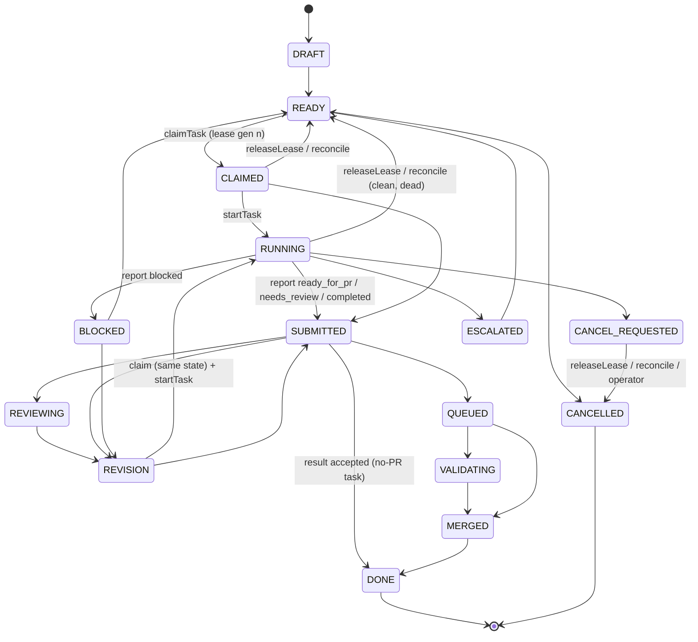
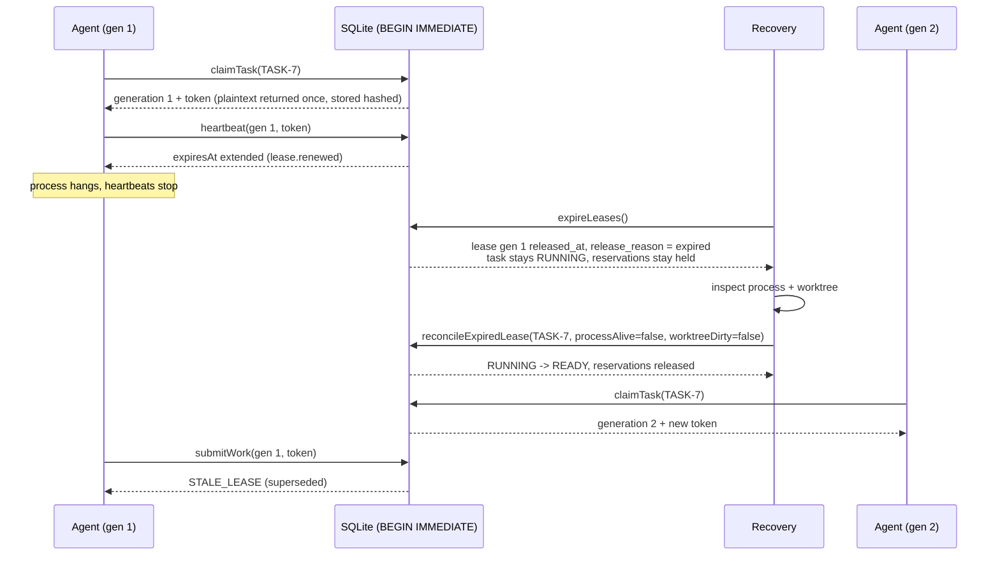

# Tasks, leases, scheduling and workspaces

Packages: `@crewyard/tasks`, `@crewyard/scheduler`, `@crewyard/workspaces`.

The deterministic core owns task state, leases, dependencies and permissions. Agents and planners only *propose*; every
mutation is a short synchronous `BEGIN IMMEDIATE` transaction that records an event and an audit row together. No
network, LLM or subprocess work happens inside a transaction, and every timestamp is taken *inside* the transaction so
event order equals commit order.

## Task state machine

Every state change goes through `applyTransition` (public wrapper: `transitionTask`). It calls core
`assertTransition`, bumps `revision`, releases the lease/reservations the target state no longer allows, writes
`task.transitioned` (or a more specific event type) plus audit, and releases dependents. Invalid moves return
`INVALID_TRANSITION` with `details.allowed`.

Guards on top of the core table:

| Guard | Rule |
|---|---|
| Lease-only targets | `CLAIMED` only via `claimTask`; `RUNNING` only via `startTask` with a valid lease. |
| DONE invariant | `DONE` only from `MERGED`, or for tasks that need no PR (`kind = 'epic'` or no repository) after a `completed` handoff. |
| GitHub actor | An actor of kind `github` cannot transition a leased task, edit, pause, reorder or assign. Observed PR status never changes ownership. |
| Optimistic concurrency | `updateTask`, `setPriorityOverride` and `transitionTask` accept `expectedRevision`; mismatch → `CONFLICT` (retryable). |

Leases are released automatically when a task leaves `CLAIMED`/`RUNNING`/`REVISION` for anything except
`CANCEL_REQUESTED` (the holder keeps heartbeating and sees `cancelRequested: true`). Scope reservations are released on
`DRAFT`, `READY`, `MERGED`, `DONE`, `CANCELLED`, `ESCALATED`, and on `BLOCKED` unless the handoff policy says
otherwise; they are deliberately **kept** through `SUBMITTED … VALIDATING` so a schema migration stays exclusive until
it merges.

## Leases and fencing

`claimTask` rechecks, inside one transaction: no active lease (`LEASE_CONFLICT`), state `READY` or unleased
`REVISION`, not paused, project intake not paused and autonomy not `observe` (`POLICY_DENIED`), all dependencies
`MERGED`/`DONE` (`CONFLICT`, `details.reason = dependencies_unsatisfied`), assignment, approval (`APPROVAL_REQUIRED`),
WIP limits (`POLICY_DENIED`, `wip_limit`), and scope conflicts (`RESERVATION_CONFLICT` with the conflicting task IDs).
It then inserts the lease (`generation = lease_generation + 1`, token stored as `hashToken`), reserves scopes and moves
`READY → CLAIMED`. The partial unique indexes `leases_one_active` and `reservations_exclusive_active` are the last line
of defence: any constraint violation is mapped to the same typed errors.

Every holder call (`heartbeat`, `startTask`, `reportProgress`, `report`/`submitWork`/`reportBlocker`/`completeTask`,
`releaseLease`) passes `{ taskId, generation, token }` and goes through `verifyLeaseInTx`:

| Condition | Error |
|---|---|
| unknown generation, superseded generation, released or expired lease | `STALE_LEASE` (`details.reason`) |
| token does not match the generation | `NOT_AUTHORIZED` |

Expiry is not takeover. `expireLeases` only marks the lease `expired` and emits `lease.expired` with
`needsReconciliation: true`; the task stays in its state (claims fail with `LEASE_CONFLICT`,
`awaiting_reconciliation`) and exclusive reservations stay held, because the old process may still be writing.
`reconcileExpiredLease(taskId, { processAlive, worktreeDirty })` decides:

| Input | Outcome |
|---|---|
| process alive | `deferred_process_alive` (terminate first) |
| `CANCEL_REQUESTED` | `cancelled` |
| worktree dirty | `preserved`: task → `BLOCKED` with blocker reason; workspace kept for recovery |
| otherwise | `released`: task → `READY` |

`forceReleaseLease` is operator-only, requires a reason, and is audited with decision `forced`.

### Execution ownership and interrupted dispatch

A managed dispatch also has a durable execution attempt. The task claim transaction writes
`lease.execution_bound` with that exact attempt, lease ID, generation and holder. Recovery can therefore identify
the lease even if cancellation happens during workspace bootstrap, before provider progress is recorded.

Execution recovery first proves the worker and its recorded children have exited. It closes only sessions bound
to that attempt's task generation and rechecks the original active lease while preserving Git changes. Successful
preservation commits pending work to the task branch and returns a still-owned task to `READY`, or to `CANCELLED`
if it was `CANCEL_REQUESTED`. A task already handed off or owned by a newer generation is not reset. This dispatch
path is distinct from the generic expired-lease reconciliation table above; unverifiable ownership or failed
preservation requires intervention and retains resources.

## Dependencies

Dependencies are a DAG per project (`task_dependencies`). Additions and updates run `assertAcyclicWith` (DFS on the
project graph plus the proposed edges) and fail with `CYCLE_DETECTED` and the cycle path. A dependency is satisfied when
it is `MERGED` or `DONE`. Dependents stay `READY`; `TaskView.blockedByDependencies` is the computed view and
`listTasks({ dispatchable: true })` filters on it. When a task first enters a satisfied state, one
`task.dependencies_satisfied` event is written for each dependent whose dependencies are now all satisfied. A retried
transition is rejected by the state machine, so the release event cannot be duplicated.

## Goals and plans

`createGoal` → `GOAL-<n>`. `proposePlan` always validates the plan: unique keys, no cycles, known dependencies (plan keys
or existing task IDs), repositories of the project, acceptance criteria, and scope hints or an explicit `scopeReason`.
An invalid plan is stored with `plan_errors` and never materialises. Approval policy (`planApprovalRequired`):
`observe`/`assisted` always need an approval; `guarded` needs one for AI plans; `autopilot` auto-approves. Approval
materialises tasks in topological order (`TASK-<n>`, `DRAFT → READY`) in the same transaction. `cancelGoal` cancels
idle tasks and moves active ones to `CANCEL_REQUESTED`.

## Risk and approvals

`classifyRisk` matches scope hints and changed paths against `security.sensitive_paths` (glob hints are probed), and
namespaced resources (`schema:`, `migration:`, `auth:`, `deploy:` …) against fixed classes. `high-risk` is always
required for `risk = high`. Required classes are those in `security.require_approval_for`, plus `high-risk`. The task
gets `requires_approval` and a pending `approvals` row (subject `task`). Only an operator (or `system` policy) can
decide approvals.

## Scheduler

`buildSchedulerSnapshot` reads one project. `admitTasks(snapshot, config)` is pure and deterministic (FR-TSK-06/07,
§21.1):

1. Policy filter with exact reason codes: `NOT_DISPATCHABLE_STATE`, `ALREADY_LEASED`, `AUTONOMY_OBSERVE`,
   `INTAKE_PAUSED`, `WORKERS_PAUSED`, `TASK_PAUSED`, `APPROVAL_PENDING`, `DEPENDENCIES_UNSATISFIED`,
   `EXCLUSIVE_SCOPE_CONFLICT`.
2. Ordering: `REVISION` (recovery) work first, then by fairness mode. `weighted` sums priority (override +1000),
   unblock potential (transitive dependents ×5, max 30), advisory-overlap penalty (−10 per overlapping task, max −30),
   age (+0.5/h, max 20), deadline (+10/+25/+40), budget size (up to −10) and project share (up to −20). `fifo` and
   `strict-priority` are also available. Ties always break on the task ID.
3. Capacity (`computeIntakeCapacity`): `min(global WIP or agents.max_parallel, project WIP, provider capacity)`, or
   zero if a budget is exhausted. When open PRs reach `max_open_prs` or the oldest queue entry exceeds
   `max_queue_age_minutes`, new implementation is stopped (`BACKPRESSURE_*`) but recovery work keeps the full
   capacity. Otherwise `min(reserve_recovery_capacity, recovery demand)` slots are kept for recovery work. Repository,
   agent and account WIP, task budgets, and exclusive conflicts between tasks admitted in the same round are then
   applied.

The output is advisory. `explainDispatch(taskId)` returns the admission or the exact deferral. Claiming is still the
atomic recheck.

## Workspaces

- **Allocation**: an active workspace record is reserved/rechecked inside `BEGIN IMMEDIATE` before Git runs.
  Concurrent allocators reuse that record; an incomplete allocation requires reconciliation. Then
  `git worktree add -b <branch> <dirs.worktrees>/<ws_id> <base sha>` runs from the repository's
  canonical path. The base is `origin/<base>` if present, else the local ref. The branch comes from
  `integration.branch_name_format`. If the branch already exists it is reused, which lets recovery continue preserved
  work. The primary checkout's files and HEAD are never touched. Untrusted repositories run Git with
  `core.hooksPath` pointing to an empty directory, so repository hooks cannot execute.
- **Paths**: every file operation goes through `safeJoin`/canonical paths. A workspace must live under
  `dirs.worktrees`, and must neither contain nor be inside the primary checkout.
- **Preservation**: `backupWorkspace` writes `worktree.patch` (`git diff --binary` produced through a temporary
  `GIT_INDEX_FILE`, which includes untracked files without touching the user's index or stash) and `commits.bundle`
  (unpushed commits since base), then records `workspace_artifacts`. `removeWorkspace` and `resetWorkspace` refuse
  dirty work (or branch deletion with unpushed commits) without a `DestructiveAuthorization`, and always back up
  first. Crashes leave the worktree intact (`markWorkspacesForReconciliation`); `collectCommits` attributes commits
  since base to the owning task.
- **Cleanup**: `previewCleanup` lists every workspace with block reasons (active lease/session/execution, allocation,
  open PR, unfinished task, manual policy, retention, needs reconciliation) and a fingerprint. `applyCleanup` requires that fingerprint,
  and refuses with `CONFLICT` if anything changed since the preview. Commits reachable from locally present heads
  of merged PRs matching the repository and branch/task count as published, including squash merges whose remote
  task branch was deleted. Descendants not covered by that evidence remain protected as unpublished work.
- **Bootstrap**: `workspace.setup_commands` and `install_commands` run through `runBounded` with an allowlisted
  environment, injected secret references (`npm-token` → `NPM_TOKEN`, resolved by the caller), a timeout and an
  output limit. Logs are scrubbed of secret values and stored as `bootstrap_log` artifacts. For untrusted
  repositories the commands need an approved `repo_hooks` approval, bound to the fingerprint of the command list.
- **Bounded execution**: `runBounded` validates the working directory against the permitted roots, refuses to run as
  root, sanitises the environment, enforces the timeout and output limit, and terminates the process tree.
  `platformLimitations()` lists what is *not* enforced. Worktrees are not a security sandbox.

Review and candidate validation worktrees are disposable resources with an exact attempt manifest registered
before creation. They may be removed only after the owning processes are verified gone. Partial paths without
verifiable registration are preserved and reported. Task worktrees follow the separate preservation/cleanup policy
above; cancelling a worker does not authorize deleting task work.

## Schema notes

- Approval classes per task are stored in `tasks.artifacts.approval` (`requiredClasses`/`approvedClasses`), because
  `approvals` has no class column and allows only one pending row per subject.
- "Needs reconciliation" for tasks is derived (leased state, no active lease, last lease `release_reason = 'expired'`);
  there is no dedicated column.
