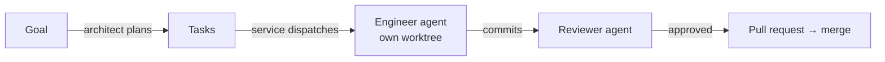

# Getting started

This guide takes you from nothing to agents working on your repository. Every command here was run as written.

## How it works

You give Crewyard a **goal**. An **architect** agent splits it into **tasks**. The **service** hands each ready task to an **engineer** agent, which works in its own Git worktree using one of your **accounts**. A **reviewer** agent checks the work, and Crewyard opens and merges the pull request.



| Thing | What it is | Created with |
|---|---|---|
| **Project** | A Git repository Crewyard coordinates | `crew init` |
| **Account** | A login for an agent CLI you already use (Claude Code, Codex, OpenCode) | `crew account add` |
| **Agent** | A worker with a role (architect, engineer, reviewer) that uses an account | `crew agent create` |
| **Goal → tasks** | What you want done, split into tasks with dependencies | `crew goal create` + `crew goal plan` |
| **Service** | The background worker that keeps dispatching tasks | `crew service start` |

Everything is stored locally in one SQLite database. Nothing runs in the cloud except the agent CLIs' own model calls and GitHub.

## The steps at a glance

| # | Step | Command | Required? |
|---|---|---|---|
| 1 | Install and check your machine | `npm install -g crewyard` · `crew doctor` | Yes |
| 2 | Register your repository | `crew init --repo .` | Yes |
| 3 | Add an account | `crew account add …` | Yes |
| 4 | Create agents | `crew agent create …` | Yes |
| 5 | Turn on AI review | `crew config set review.reviewer_agent reviewer` | Recommended |
| 6 | Connect your own agent tools | `crew install` | Optional |
| 7 | Give it a goal and approve the plan | `crew goal create` · `crew goal plan` · `crew goal approve` | Yes |
| 8 | Watch one task | `crew agent run engineer --task TASK-1` | Recommended |
| 9 | Let it run | `crew service start` · `crew dashboard` | Yes |

## 1. Install

You need Git 2.38+, Node.js 22+, and at least one agent CLI that you are logged in to: [Claude Code](https://code.claude.com/docs) (`claude`), [Codex CLI](https://github.com/openai/codex) (`codex`) or [OpenCode](https://opencode.ai) (`opencode`). For pull requests, also the [GitHub CLI](https://cli.github.com/), logged in with `gh auth login`.

```bash
npm install --global crewyard
crew doctor
```

Every line of `crew doctor` should say `OK`. A `provider.*` line that is not OK means that agent CLI is missing ([what each check means](doctor.md)).

## 2. Register your repository

```bash
cd ~/src/my-repo
crew init --repo .
```

This writes `.crewyard/config.yaml` (safe to commit), indexes the code, and prints a readiness report. The ✗ lines are what the next steps fix. For pull requests the repository needs a GitHub `origin` remote.

## 3. Add an account

Reuse the login you already have in the agent CLI:

```bash
crew account add --provider claude --name personal --use-default-config
crew account test claude/personal          # should say "healthy"
```

Use `--provider codex` or `--provider opencode` the same way. For a separate login, several accounts or an API key, see [Accounts](accounts.md).

## 4. Create agents

Run these inside the repository. The provider comes from the account.

```bash
crew agent create --name architect --role architect --account claude/personal
crew agent create --name engineer  --account claude/personal
crew agent create --name reviewer  --role reviewer  --account claude/personal
crew agent list
```

- **architect** turns a goal into a task plan
- **engineer** implements tasks (the default role)
- **reviewer** reviews work before it is merged

An agent created inside a registered repository only works on that project (the `PROJECTS` column of `crew agent list`). To share one across projects: `crew agent update engineer --all-projects`.

Agents can use different providers, and one agent can use several accounts in order. Changing, removing and sharing agents is covered in [Agents and policies](agents.md).

## 5. Turn on AI review

Without this, Crewyard reviews with static checks only:

```bash
crew config set review.reviewer_agent reviewer --yes
```

## 6. Connect your own agent tools (optional)

This step is for the Claude Code, Codex and OpenCode sessions **you** start yourself: it lets them see Crewyard's tasks and tools. Agents that Crewyard launches in steps 8 and 9 work without it.

```bash
crew install --dry-run      # shows every file it would change
crew install                # all hosts; or --target claude,codex,opencode
```

It does two things for each tool: registers `crew mcp` as an MCP server, and copies the six `crew-*` Skills. Anything it changes is backed up first, and `crew uninstall` restores the originals.

**Where things are installed** with the default `--scope user` (for you, in every repository):

| Tool | MCP server registered in | Skills copied to |
|---|---|---|
| Claude Code | `~/.claude.json`, via `claude mcp add-json --scope user` | `~/.claude/skills/crew-*` |
| Codex | `~/.codex/config.toml` (or `$CODEX_HOME`) | `~/.agents/skills/crew-*` |
| OpenCode | `~/.config/opencode/opencode.json` | `~/.agents/skills/crew-*` |

With `--scope project` (shared with your team through the repository):

| Tool | MCP server registered in | Skills copied to |
|---|---|---|
| Claude Code | `.mcp.json` | `.claude/skills/crew-*` |
| Codex | `.codex/config.toml` (Codex loads it only for trusted projects) | `.agents/skills/crew-*` |
| OpenCode | `opencode.json` | `.agents/skills/crew-*` |

`crew hosts` shows what is registered where. Exact file contents are in [MCP host setup](mcp-hosts.md), and what each Skill does is in [Skills](skills.md).

An agent that Crewyard launches with an account added with `--use-default-config` reads the same configuration, so with a user-scope install it also gets Crewyard's tools and Skills. Agents on a [separate login](accounts.md#a-separate-login) use their own configuration directory and don't get them yet: they still work, and Crewyard renews their task lease and submits their commits when the session ends.

## 7. Give Crewyard a goal

```bash
crew goal create --title "Add a greeting helper" --description "Add greet(name) to src/greet.ts with a test."
```

It prints the goal ID, such as `GOAL-1`. Then plan it, in one of two ways.

**Let the architect plan it.** Plans written by an AI wait for your approval:

```bash
crew goal plan GOAL-1 --agent architect
crew goal status GOAL-1                # read the proposed tasks
crew goal approve GOAL-1 --yes         # creates the tasks
```

**Or write the plan yourself** as YAML or JSON. Your own plans are accepted immediately:

```yaml
# plan.yaml
summary: Add a greeting helper
tasks:
  - key: greet
    title: Add greet(name)
    objective: Add an exported greet(name) to src/greet.ts that returns "Hello, <name>!".
    acceptanceCriteria: ["greet('Ada') returns 'Hello, Ada!'"]
    dependencies: []
    scopeHints: [src/greet.ts]
    risk: low
  - key: greet-test
    title: Test greet
    objective: Add a unit test for greet.
    acceptanceCriteria: ["the test fails if greet changes its output"]
    dependencies: [greet]
    scopeHints: [src/greet.test.ts]
    risk: low
```

```bash
crew goal plan GOAL-1 --file plan.yaml
crew task list
```

```text
ID      STATE  PRIORITY  RISK  TITLE            DEPS
TASK-1  READY  50        low   Add greet(name)  []
TASK-2  READY  50        low   Test greet       ["TASK-1"]
```

Whether AI plans need approval depends on `autonomy` in `.crewyard/config.yaml`: `guarded` (the default) asks for AI plans only, `observe` and `assisted` ask for every plan, `autopilot` never asks.

## 8. Run one task and watch it

Before you let Crewyard run on its own, watch a single task:

```bash
crew agent run engineer --task TASK-1
```

The engineer claims the task, gets its own Git worktree (your checkout is never touched), and works in the foreground until it finishes. `crew task show TASK-1` shows where the task ended up.

## 9. Let it run

```bash
crew service start      # dispatches ready tasks, syncs GitHub, runs the merge queue
crew dashboard          # live view of tasks, agents, PRs and alerts
```

The service picks an agent for each ready task by role (`engineer` unless the task asks for another), using agents that have free capacity (`--max-parallel`). To keep it running across reboots: `crew service install`.

| Question | Command |
|---|---|
| Why isn't TASK-2 running? | `crew task explain TASK-2` |
| What is each agent doing? | `crew agent sessions` |
| Show a session's output | `crew agent logs <sessionId>` |
| Why isn't a PR merging? | `crew queue explain --pr <number>` |
| Is the service up? | `crew service status` |
| Stop it | `crew service stop` |

## Troubleshooting

| Symptom | Fix |
|---|---|
| `crew account test` says `unauthenticated` | Run the command it suggests: `crew account login <account>` |
| `error APPROVAL_REQUIRED … confirmation required` | Add `--yes` to confirm, or `--dry-run` to preview |
| `Goal … has no plan awaiting approval` | The plan was already accepted. Check `crew task list` |
| Tasks stay `READY` | Start the service (`crew service start`), check `crew task explain <task>`, and that an agent with the right role works on this project (`crew agent list`) |
| Reviews never use your reviewer agent | `crew config set review.reviewer_agent reviewer --yes` |
| `✗ remote` in the readiness report | Add a GitHub `origin` remote and run `gh auth login` |

More in [`crew doctor`](doctor.md) and the [recovery runbooks](incident-recovery/runbooks.md). Every command is in the [CLI reference](reference/cli.md).
