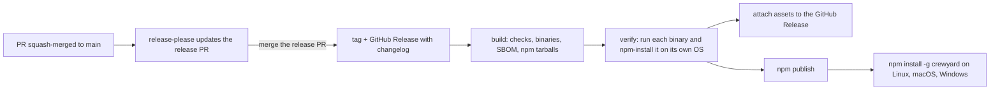

# Releasing

Releases are automated with [release-please](https://github.com/googleapis/release-please) in [`release.yml`](../.github/workflows/release.yml). Nobody edits versions, writes changelog entries, or pushes tags by hand.



## How versions and the changelog are decided

Pull requests are squash-merged, so each PR title becomes one commit on `main`. The **PR title** check enforces [Conventional Commits](https://www.conventionalcommits.org/) titles.

| Title | Changelog section | Version bump |
|---|---|---|
| `feat: …` | Features | minor |
| `fix: …`, `perf: …`, `deps: …` | Bug Fixes, Performance, Dependencies | patch |
| `feat!: …` or a `BREAKING CHANGE:` footer | marked breaking | minor while pre-1.0, then major |
| `docs: …` | Documentation | patch |
| `refactor`, `test`, `build`, `ci`, `chore` | not listed | — |

After each merge to `main`, release-please opens or updates one release PR. It bumps `version` in `package.json` and every workspace package, updates the version in `docs/installation.md`, and adds the release's entries to `CHANGELOG.md`. The release job authenticates as the `Crewyard Release` GitHub App (secrets `RELEASE_APP_CLIENT_ID` and `RELEASE_APP_PRIVATE_KEY`), so the release PR triggers CI and CodeQL like any other pull request, without a maintainer approving the runs. Merging the release PR does not run CI or CodeQL again on `main`: the release commit only changes versions and the changelog, which the release PR's checks already covered.

To force a specific version, add a `Release-As: 1.0.0` footer to a commit on `main`.

## Cut a release

Before merging the release PR, review the [acceptance matrix](acceptance.md), not just the presence of CI jobs.
Record actual runner results for packaged workers on every claimed platform, including process identity,
cancellation, child drain and recovery. Linux local results do not establish macOS or Windows acceptance.
Real GitHub protections, native queue checks on the merge-group SHA and authenticated Codex/Claude/OpenCode
delivery remain open gates until demonstrated; mock fixtures cannot close them.

For a schema-changing release, quiesce service, direct CLI/MCP/dashboard writers and provider children before
upgrade. Verify supported predecessor migration and legacy open-writer fencing. Follow the
[upgrade procedure](installation.md#upgrade); rollback retains the corrected schema and guards. A backup restore
requires acknowledged-write and remote-effect reconciliation and cannot undo a GitHub merge.

Review the release PR, then squash-merge it. That creates the `v<version>` tag and the GitHub Release, and the same workflow run then:

1. builds and tests the tag, cross-compiles the five binaries, and writes the SBOM, checksums and npm tarballs
2. runs every binary and npm-installs the exact tarballs on Linux x64 and arm64, macOS arm64 and x64, and Windows x64
3. attaches the binaries, `manifest.json`, `sbom.cdx.json` and `SHA256SUMS` to the release
4. publishes the five `@crewyard/cli-<os>-<arch>` packages, then `crewyard`, so `crewyard` never points at a missing binary; versions already on npm, or uploaded and still being processed by npm (`E409 … previously staged version`), are skipped, so a failed run can be re-run
5. waits up to 30 minutes until npm serves `crewyard` and every platform package (npm can take that long to process a
   large binary), then installs `crewyard@<version>` on Linux and runs `crew version`

Versions with a pre-release suffix (`1.1.0-rc.1`) go to the `next` dist-tag, others to `latest`.

## Rehearse

Run **Release** from the Actions tab (`workflow_dispatch`) on any branch. It runs build and verify on every runner and `npm publish --dry-run` for each package, and creates nothing.

## One-time npm setup

npm trusted publishing (OIDC) needs no stored token, but npm only lets you configure it for a package that already exists. The first release therefore publishes with the `NPM_TOKEN` secret, and later releases do not need it.

1. The npm organization `crewyard` owns the `@crewyard/` scope.
2. The `NPM_TOKEN` Actions secret holds a granular token with **Bypass two-factor authentication** and read and write access to all packages.
3. After the first release, register this workflow as the trusted publisher of every package (npm 11.15.0 or newer, with 2FA on your account):

   ```bash
   for pkg in crewyard @crewyard/cli-linux-x64 @crewyard/cli-linux-arm64 @crewyard/cli-darwin-arm64 \
     @crewyard/cli-darwin-x64 @crewyard/cli-win32-x64; do
     npm trust github "$pkg" --file release.yml --repo orafaelfragoso/crewyard --allow-publish --yes
   done
   ```

4. Delete the `NPM_TOKEN` secret and revoke the token. For each package, set **Settings → Publishing access** to *Require two-factor authentication and disallow tokens*; trusted publishing keeps working.

A trusted publisher configuration expires if no publish uses it within 48 hours of creation, so run step 3 shortly before the second release, or re-create it then.

## Provenance

npm provenance and GitHub artifact attestations are generated only while the repository is public, because both services support them only for public repositories. The workflow detects this on its own.
