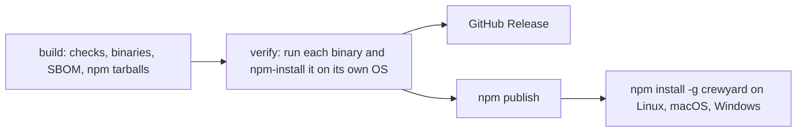

# Releasing

A release is a `v<version>` tag that matches `version` in `package.json`. Pushing the tag runs [`release.yml`](../.github/workflows/release.yml):



The npm job publishes the five `@crewyard/cli-<os>-<arch>` packages first and `crewyard` last, so `crewyard` never points at a missing binary. Versions already on npm are skipped, so a failed job can be re-run. Versions with a pre-release suffix (`1.1.0-rc.1`) go to the `next` dist-tag, others to `latest`.

## Rehearse

Run **Release** from the Actions tab (`workflow_dispatch`) on any branch. It runs build and verify on every runner and `npm publish --dry-run` for each package, and creates nothing.

## Cut a release

```bash
npm version 1.1.0 --no-git-tag-version   # or edit package.json
git commit -am "Release 1.1.0"
git tag v1.1.0
git push origin main v1.1.0
```

## One-time npm setup

npm trusted publishing (OIDC) needs no stored token, but npm only lets you configure it for a package that already exists. The first release therefore publishes with a token, and later releases do not.

1. Create the free npm organization `crewyard` at [npmjs.com/org/create](https://www.npmjs.com/org/create). It owns the `@crewyard/` scope.
2. Create a granular access token with **Bypass two-factor authentication** enabled and read and write access to all packages (the packages do not exist yet, so they cannot be selected) and the `crewyard` organization. Add it to the repository as the `NPM_TOKEN` Actions secret.
3. Push the first tag. The npm job publishes with the token.
4. Register this workflow as the trusted publisher of every package (npm 11.15.0 or newer, with 2FA on your account):

   ```bash
   for pkg in crewyard @crewyard/cli-linux-x64 @crewyard/cli-linux-arm64 @crewyard/cli-darwin-arm64 \
     @crewyard/cli-darwin-x64 @crewyard/cli-win32-x64; do
     npm trust github "$pkg" --file release.yml --repo orafaelfragoso/crewyard --allow-publish --yes
   done
   ```

5. Delete the `NPM_TOKEN` secret and the token. For each package, set **Settings → Publishing access** to *Require two-factor authentication and disallow tokens*; trusted publishing keeps working.

A new trusted publisher configuration expires if no publish uses it within 48 hours of creation, so run step 4 shortly before the second release or re-create it then.

## Provenance

While the repository is private, npm provenance and GitHub artifact attestations are skipped, because both services only support them for public repositories. Once the repository is public, the same workflow generates both without changes.
